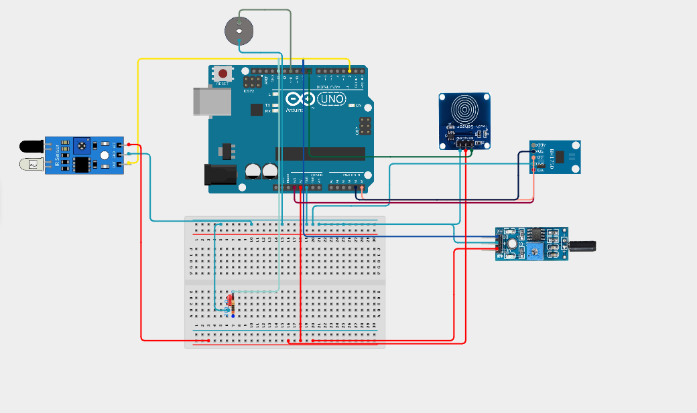
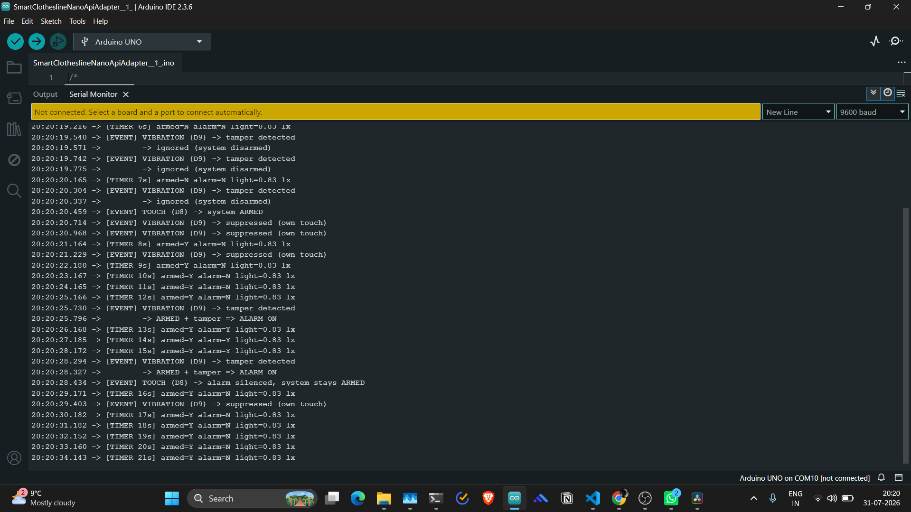

# Interrupt-Driven Intrusion and Tamper Alarm

An interrupt-driven **Sense–Think–Act** security system built on an Arduino Uno (ATmega328P).

Three different interrupt types run at the same time without interfering with each other: an
external interrupt for intrusion, a shared pin-change interrupt covering two sensors of opposite
polarity, and a Timer1 interrupt driving a periodic task once per second. No interrupt handler
does more than raise a flag; every decision, every I²C read and every serial print happens in
`loop()`.

Built for **SIT315 Concurrent and Distributed Programming**, Module 1, Task M1.T1P, at Quality
Point level 4/4.

---

## What it does

The system behaves like a small home security panel.

It starts **disarmed**. Touching the pad arms it. While armed, either an obstacle in front of the
IR sensor (an intrusion) or a shock on the vibration sensor (tampering) sets off the alarm.
Touching the pad while the alarm is sounding silences it *without* disarming, which is how a real
keypad behaves. Independently of any of that, a 1 Hz timer blinks a heartbeat LED, samples the
ambient light sensor and prints a status line.

The important idea is that **being armed and being triggered are two separate things**. The exact
same wave of a hand is logged and ignored when the system is off, and sets off the alarm when it
is on.

| Action | Result |
|---|---|
| Touch pad (disarmed) | system arms |
| Touch pad (armed, no alarm) | system disarms |
| Touch pad (alarm sounding) | alarm silenced, **stays armed** |
| IR obstacle while armed | alarm on |
| Vibration while armed | alarm on (tamper) |
| Vibration within 1.5 s of a touch | logged as `suppressed (own touch)`, no alarm |
| Any sensor while disarmed | logged, then ignored |

---

## Hardware

| Component | Pin | Notes |
|---|---|---|
| FC-51 IR proximity sensor | **D2** | External interrupt INT0, triggers on **FALLING**. Idles HIGH, drops LOW on detection. |
| TTP223B capacitive touch pad | **D8** | Pin-change PCINT0. **Active HIGH.** |
| SW-420 vibration switch | **D9** | Pin-change PCINT1. **Active LOW.** |
| BH1750 ambient light sensor | **A4 / A5** | I²C at address `0x23`. Runs on **3.3 V**, not 5 V. |
| Alarm indicator | **D13** | The Uno's onboard LED. Nothing to wire. |
| Heartbeat LED + 220 Ω | **D12** | Toggles once per second. Visible proof the timer is alive. |
| Buzzer | **D11** | Pulses in time with the 1 Hz tick while alarming. |

**D8 and D9 are both on PORTB**, which puts them in the same pin-change group and means they share
a single interrupt vector. Their opposite polarities are deliberate, not accidental: it forces the
shared handler to genuinely work out which pin moved rather than treating both the same way.

### Circuit



### Wiring order

Set the rails up first: Uno **5 V** to the red rail, Uno **GND** to the blue rail. Every sensor
module then takes VCC from the red rail, GND from the blue rail, and its signal pin to the pin in
the table above. The one exception is the BH1750, which takes VCC from the Uno's dedicated
**3.3 V** pin.

No pull-up resistors are needed. All four sensor modules have their own onboard conditioning,
which is why the code uses plain `INPUT` rather than `INPUT_PULLUP`.

---

## How the interrupts work

| Interrupt | Trigger | What the handler does |
|---|---|---|
| `INT0` via `attachInterrupt` | D2 falling edge | `irFlag = true` |
| `PCINT0_vect` | any change on D8 or D9 | snapshot `PINB`, XOR against previous, set one flag |
| `TIMER1_COMPA_vect` | every 1.000 s | `tickCount++`, `timerFlag = true` |

### Timer setup

Timer1 in CTC mode with a 1024 prescaler and `OCR1A = 15624`:

```
16 000 000 / (1024 x 1 Hz) - 1 = 15624
```

`TIMSK1 |= (1 << OCIE1A)` is what actually enables the interrupt. Configuring the timer and
switching its interrupt on are two separate steps, and leaving the second one out gives you a
timer that counts perfectly and never fires.

### Telling D8 and D9 apart

One vector serves the whole group, and it fires on **both** edges. Reading pin levels alone is not
enough: an interrupt caused by D9 would also see D8 sitting HIGH if a finger were resting on it,
and invent a touch that never happened.

The handler keeps a snapshot of the port from the previous interrupt and compares:

```cpp
uint8_t pinb    = PINB;              // read the whole port once
uint8_t changed = pinb ^ prevPINB;   // 1 in every bit that actually moved
prevPINB        = pinb;
```

Each pin then acts only if **its own bit is in `changed`** *and* it has landed in its active state.
`prevPINB` is seeded from `PINB` before the interrupt is enabled, otherwise the very first edge is
compared against zero and both pins look like they changed.

### Interrupt-safe practices

- Every handler is one to three lines. Set a flag, get out.
- No `Serial`, no `delay()`, no I²C inside any handler. The BH1750 read is *triggered* by the timer
  but *performed* in `loop()`.
- Everything shared between a handler and `loop()` is `volatile`.
- The 4-byte tick counter is copied with interrupts briefly disabled, so a half-updated value can
  never be read.
- 200 ms debounce on both pin-change inputs. The SW-420 chatters badly on a single tap.
- `tone()` runs on Timer2 on purpose, so the buzzer can never disturb the Timer1 tick.

---

## Serial output



```
[TIMER 7s] armed=N alarm=N light=0.83 lx
[EVENT] VIBRATION (D9) -> tamper detected
        -> ignored (system disarmed)
[EVENT] TOUCH (D8) -> system ARMED
[EVENT] VIBRATION (D9) -> suppressed (own touch)
[TIMER 8s] armed=Y alarm=N light=0.83 lx
[EVENT] VIBRATION (D9) -> tamper detected
        -> ARMED + tamper => ALARM ON
[EVENT] TOUCH (D8) -> alarm silenced, system stays ARMED
```

Two things worth noticing in that log:

1. **`[TIMER n s]` never skips a number**, even when several sensor events land inside the same
   second. The periodic task and the event-driven path do not interfere with each other. That is
   the whole concurrency claim, visible in one screenshot.
2. The `suppressed (own touch)` lines are the tamper-suppression window doing its job. Pressing the
   touch pad physically shakes the desk enough for the vibration sensor to feel it, so events
   arriving within 1.5 s of a touch are logged but not acted on.

---

## Build and upload

1. Open `TaskM1.ino` in the Arduino IDE. If it asks to move the sketch into its own folder, say yes.
2. **Tools → Board → Arduino Uno**, then pick the COM port.
3. Upload.
4. Open **Serial Monitor at 9600 baud**.

No external libraries are needed. The BH1750 is driven over raw I²C using the built-in `Wire`
library, so there is nothing to install.

---

## Test conditions

| Test | What changes | Why |
|---|---|---|
| Wave at the IR sensor disarmed, then armed | Ignored first, alarm second | The decision rule needs two conditions, `systemArmed && intrusion`. The sensing was identical both times; only the state differed. |
| Silence the alarm, then re-trigger | Alarm clears but the system stays armed; the next event fires it again | State survives the silence. Tapping within 1.5 s is suppressed, tapping later is not. |
| Change `OCR1A` to `7811` (~2 Hz) or `31249` (~0.5 Hz) | Heartbeat and log rate change; sensor events behave identically | The two paths share no timing dependency, which is what "separation of time-based and event-based logic" means in practice. |

---

## Repository layout

```
.
├── TaskM1.ino     the complete program
├── README.md      this file
└── images/
    ├── circuit_diagram.png
    └── serial_monitor.png
```

---

## Notes

Three problems shaped the final design, and all three are worth reading the code for:

- The BH1750 was silently dead because SDA and SCL were swapped. A bus scanner returning *nothing
  at any address* is what proved it was wiring rather than a wrong address constant.
- The touch pad and the vibration sensor turned out to be **physically** coupled through the desk,
  even though they are logically independent. Fixed with the sensitivity pot in hardware and a
  suppression window in software.
- The pin-change handler originally read pin *levels* instead of *edges*, which let one sensor's
  interrupt invent an event on the other. The `prevPINB` XOR above is the fix.

---

**SIT315 Concurrent and Distributed Programming** · Deakin University · Module 1, Task M1.T1P (4/4)
